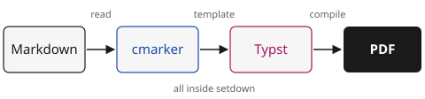
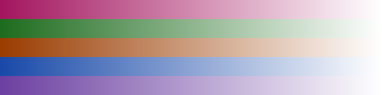

Images are referenced with paths relative to the Markdown file, which is also how GitHub and most editors resolve them. They must lie in the file's directory or below it; images from the web do not work, since setdown never goes online.

## SVG and PNG

An image on its own line is set at its natural size, shrunk to the width of the text if it is wider. Vector graphics in SVG stay sharp at any zoom, and their text is set in the bundled fonts. Quote a font name that ends in a number, as in `font-family="'Source Sans 3'"`; without the quotes, SVG takes the name for invalid and uses the body font instead:

PNG, JPEG, GIF and WebP work as well:

The text in the brackets is the alternative text. It is not shown. With `--pdf-level ua1` or `a3b`, it is stored in the PDF for screen readers and other assistive technology, so it should describe what the image shows; the [PDF/UA-1 example](../17-pdf-ua1/pdf-ua1.md) shows more. The default level leaves it out, along with everything else only screen readers use.

## Captions

A caption needs HTML: a `figure` around the image with a `figcaption`. Typst numbers the figures.

<figure>

<figcaption>How setdown turns Markdown into a PDF</figcaption>
</figure>

## Size

The HTML `img` element can set a width or height, in percent of the text width or in points:

## Inline SVG

An SVG can also be written straight into the Markdown:

<svg xmlns="http://www.w3.org/2000/svg" width="120" height="40" viewBox="0 0 120 40">
  <circle cx="20" cy="20" r="16" fill="#a3155f"/>
  <circle cx="60" cy="20" r="16" fill="#1849a8"/>
  <circle cx="100" cy="20" r="16" fill="#1d6b1d"/>
</svg>

## Paths with spaces

A path that contains spaces goes into angle brackets: ``.
