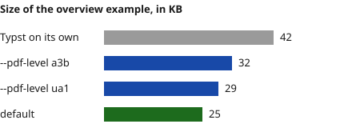

This document is a PDF/UA-1 file, the standard for PDFs that screen readers and other assistive technology can follow. Its `options.txt` holds the option it is rendered with:

```bash
setdown --pdf-level ua1 pdf-ua1.md
```

The pages look as they would at the default level. What changes is inside the file: tags that say what each piece of text is, a language, and metadata that names the standard. Typst checks the document against PDF/UA-1 and refuses one that breaks a rule, with a message that says which.

## What the tags hold

A screen reader does not see the page; it reads the tags, in the order of the Markdown:

- **Headings** with their level. The front matter's title is level 1, so the document's own headings start at `##`.
- **Paragraphs, lists and block quotes**, so that a list is announced with its number of items.
- **Tables** with their header cells, so that each cell can be read with its column's name.
- **Links and footnotes**, which can be followed from where they stand.[^order]
- **Images** with their alternative text.

The document's language, here English from the default `lang`, tells the screen reader how to pronounce the text.

[^order]: The footnote's text is tagged as a note that belongs to its mark, wherever it is printed.

### Headings in order

PDF/UA-1 does not allow a level to be skipped: after a `##`, the next deeper heading is `###`, as this one is. A `####` right after a `##` fails with "skipped from heading level 2 to 4". A document without a title starts its headings at `#`.

## Images need alternative text

The text in the brackets of an image is its alternative text, read in place of the image:



It should say what the image shows, as this one gives the numbers the bars stand for. An image without it makes the conversion fail with "missing alt text".

## Tables

The first row of a Markdown table is its header. Each cell below is read together with it:

| Level     | Tags | XMP metadata | Checked against        |
|:----------|:----:|:------------:|:-----------------------|
| `default` |  no  |      no      | nothing                |
| `a3b`     | yes  |     yes      | PDF/A-3b               |
| `ua1`     | yes  |     yes      | PDF/UA-1               |

## What no tool checks

A file can conform to PDF/UA-1 and still be hard to use. Typst checks the structure, not the meaning:

- Alternative text must describe the image, not repeat its file name.
- Link text should say where it leads, such as [the website of the PDF Association](https://pdfa.org/), not "click here".
- Color alone should not carry meaning. The highlighting theme for code keeps a contrast of at least 4.5:1 against its background.
